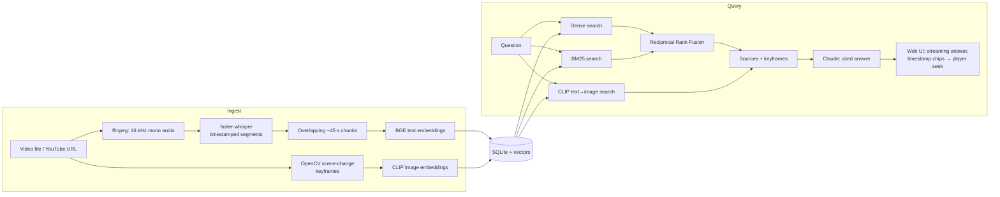

<p align="center">
  
</p>

<h1 align="center">Winter</h1>

<p align="center">
  <strong>Chat with your videos.</strong><br />
  Multimodal retrieval over speech and keyframes, with every answer cited by timestamp.
</p>

Ask a question about hours of video and get a grounded answer in seconds. **Every claim links to the
exact moment it came from**: click a citation and the player jumps there.

It searches **what was said** (Whisper transcripts) and **what was shown** (keyframes searched with
CLIP and passed to Claude as images), so it can answer "when do they show the architecture diagram?"
as well as "what did they say about pricing?".

```
You:    How much did API latency improve after the caching work?
Answer: Average API latency dropped from 320 ms to 90 ms after engineering shipped a
        Redis caching layer in August [0:13] [0:28].
                                       ^ click: video seeks to 0:13
```

**Use cases:** searching meeting and webinar recordings · course and lecture Q&A · searching
support or training video libraries · reviewing research interviews · compliance review of
recorded calls · internal knowledge bases built from Loom/Zoom recordings.

---

## Features

| | |
|---|---|
| **Any video source** | Drag-and-drop upload (mp4, mov, mkv, webm, mp3, wav…) or paste a YouTube URL |
| **Timestamped transcripts** | `faster-whisper` speech-to-text with voice-activity filtering; runs on CPU, faster on a GPU, 90+ languages |
| **Visual understanding** | Scene-change keyframe detection (OpenCV) plus CLIP image embeddings, so text queries find matching frames |
| **Hybrid retrieval** | Dense embeddings (BGE) and BM25 keyword search, merged with Reciprocal Rank Fusion |
| **Multimodal answers** | Transcript excerpts and the matching keyframes go to Claude, which answers with inline `[n]` citations |
| **Clickable citations** | Each citation is a timestamp chip; clicking it seeks the player. Source cards show the frame and excerpt |
| **Streaming** | Answers stream token by token over Server-Sent Events |
| **Works without an API key** | Uses a local model through [Ollama](https://ollama.com) when no key is set; with no model at all, it returns the best-matching moments, so search still works |
| **Scoped search** | Search the whole library or a single video; follow-up questions keep conversation context |
| **Production basics** | Background ingest queue with live progress, resume after restart, Docker image, CI, tests |

## Architecture



### Design decisions

- **Chunking on segment boundaries.** Chunks are about 45 s windows with about 10 s of overlap, and
  they never split a Whisper segment. Every citation starts at a real sentence boundary, and an
  answer that spans two chunks can still be retrieved from one of them.
- **Hybrid search, fused by rank.** Dense embeddings handle paraphrases ("how fast is it now"). BM25
  handles exact terms that embeddings blur: product names, error codes, numbers. RRF combines the two
  by rank, so the scores never need calibrating against each other.
- **Two kinds of visual evidence.** CLIP finds frames that match the question even when nothing is
  being said, such as a slide or a demo. Claude then receives the actual keyframe images, so it can
  read slide text, code on screen and diagrams.
- **Exact vector search on NumPy, no vector database.** A brute-force cosine search over an in-memory
  matrix is exact, needs no extra service, and stays fast up to a few hundred thousand chunks
  (roughly a few thousand hours of video). `VectorIndex` in `store.py` is the one class to replace if you move
  to pgvector, Qdrant or LanceDB.
- **Prompting for grounded answers.** The model must cite every claim, say when the videos don't
  cover a question instead of guessing, and allow for speech-recognition misspellings.

## Quick start

### Docker (recommended)

Needs only [Docker](https://docs.docker.com/get-docker/) (Docker Desktop on Windows/macOS).

```bash
git clone https://github.com/<you>/winter.git
cd winter
docker compose up -d --build
```

Open **http://localhost:8000**. That one command:

- builds the Winter image (Python, ffmpeg, CPU PyTorch)
- starts [Ollama](https://ollama.com) and pulls a small local model (`qwen2.5:3b`, ~1.9 GB), so you can
  chat **with no API key**
- keeps your videos, index and downloaded models in Docker volumes, so restarts are instant

The first start takes a few minutes for the downloads. Follow along with `docker compose logs -f`.
The header shows `LOCAL qwen2.5:3b` once the model is ready; until then, answers list the matching
passages.

**Use Claude instead** (better answers, and it can read the keyframes):

```bash
cp .env.example .env          # set ANTHROPIC_API_KEY=...
docker compose up -d          # Claude is used whenever a key is set
```

**Common tweaks**, all set in `.env`:

| Want | Set |
|---|---|
| A different port | `WINTER_PORT=8080` |
| A bigger/smaller local model | `VIDEORAG_OLLAMA_MODEL=llama3.2:3b` (or `qwen2.5:7b` with 16 GB+ RAM) |
| No local model at all | run `docker compose up -d winter` (starts only the app) |
| NVIDIA GPU for the local model | `docker compose -f docker-compose.yml -f docker-compose.gpu.yml up -d` |

**Day to day:**

```bash
docker compose stop                  # stop, keep everything
docker compose up -d --build         # update after a git pull
docker compose exec winter python -m videorag list    # CLI inside the container
docker compose down -v               # remove containers AND all data/models
```

### Without Docker

Requirements: Python 3.10+ and [ffmpeg](https://ffmpeg.org/download.html) on `PATH`.

```bash
python -m venv .venv
# Windows: .venv\Scripts\activate    macOS/Linux: source .venv/bin/activate
pip install -e .

cp .env.example .env          # optional: add your ANTHROPIC_API_KEY
winter serve                  # open http://127.0.0.1:8000
```

The Whisper, BGE and CLIP models (about 1 GB in total) download on first use and are cached afterwards.

For answers without an API key, install [Ollama](https://ollama.com/download) and run
`ollama pull qwen2.5:3b`. Winter detects the running model automatically.

### How answers are generated

| Setup | Who writes the answer |
|---|---|
| `ANTHROPIC_API_KEY` set | Claude, using transcripts **and** keyframe images |
| No key, Ollama running with the model pulled | The local model, using transcripts only |
| Neither | No generated answer; Winter lists the best-matching moments |

Force one with `VIDEORAG_LLM=claude|ollama|none`. A 3B local model is fine for factual lookups but
cites less consistently than Claude.

### CLI

```bash
winter ingest talk.mp4 "https://www.youtube.com/watch?v=..."
winter list
winter search "rate limiting" -k 5
winter ask "What did they recommend for rate limiting?"
```

## API

The interactive OpenAPI docs are at `/docs`.

| Method | Path | Description |
|---|---|---|
| `POST` | `/api/videos` | Upload a file (multipart `file`) and queue it for ingest |
| `POST` | `/api/videos/url` | `{"url": "..."}`: download and ingest |
| `GET` | `/api/videos` | List the library with status and ingest progress |
| `GET` | `/api/videos/{id}/transcript` | Transcript chunks with timestamps |
| `GET` | `/api/videos/{id}/media` | Video stream (supports HTTP Range for seeking) |
| `DELETE` | `/api/videos/{id}` | Remove a video and its index |
| `POST` | `/api/search` | `{"query", "video_ids"?, "k"?}`: ranked sources only, no LLM call |
| `POST` | `/api/ask` | `{"question", "video_ids"?, "history"?}`: SSE stream of `sources`, `delta`… then `done` |

## Configuration

Every setting is an environment variable. See [`.env.example`](.env.example) for the full list.

| Variable | Default | Notes |
|---|---|---|
| `ANTHROPIC_API_KEY` | none | Enables Claude answers. Without it, a local Ollama model is used if available |
| `VIDEORAG_LLM` | `auto` | `claude`, `ollama` or `none` to force a backend |
| `VIDEORAG_OLLAMA_MODEL` | `qwen2.5:3b` | Any model from the [Ollama library](https://ollama.com/library) |
| `OLLAMA_HOST` | `http://127.0.0.1:11434` | Set automatically in Docker |
| `WINTER_PORT` | `8000` | Host port for `docker compose` |
| `VIDEORAG_WHISPER_MODEL` | `base` | `small` or `medium` are more accurate but slower; `large-v3` needs a GPU |
| `VIDEORAG_WHISPER_DEVICE` | `auto` | `cuda` for an NVIDIA GPU |
| `VIDEORAG_TEXT_MODEL` | `BAAI/bge-small-en-v1.5` | Use `BAAI/bge-m3` for multilingual libraries |
| `VIDEORAG_CLAUDE_MODEL` | `claude-opus-5-5` | Any Claude model ID |
| `VIDEORAG_CLAUDE_EFFORT` | `medium` | `low` is faster and cheaper; `high` reasons more deeply |
| `VIDEORAG_CHUNK_SECONDS` / `_OVERLAP` | `45` / `10` | Retrieval granularity |
| `VIDEORAG_SCENE_THRESHOLD` | `0.35` | Lower it to capture more keyframes |

## Project layout

```
videorag/
  media.py        ffmpeg/ffprobe helpers, yt-dlp download
  transcribe.py   faster-whisper speech-to-text
  frames.py       scene-change keyframe extraction
  chunking.py     segment → overlapping chunk windows
  embeddings.py   BGE text and CLIP image embeddings
  store.py        SQLite persistence + in-memory vector index
  retrieval.py    hybrid search (dense + BM25 + RRF) and visual search
  llm.py          prompt construction; streaming answers from Claude or Ollama
  pipeline.py     ingest orchestration with progress reporting
  api.py          FastAPI app (REST + SSE) serving the web UI
  cli.py          command-line interface
  web/            dependency-free HTML/CSS/JS front end
tests/            unit and API tests (no model downloads needed)
```

## Development

```bash
pip install -e ".[dev]"
pytest -q
ruff check . && ruff format --check .
```

The tests use stub embeddings, so they run in a few seconds with no GPU, models or API key.

## Roadmap

- Speaker diarization ("what did *Sarah* say about…")
- Auto-generated chapters and summaries per video
- Multi-tenant auth and per-user libraries
- Swappable vector backends (pgvector / Qdrant) for very large libraries
- Live-stream ingestion

## License

MIT. See [LICENSE](LICENSE).

Third-party components: faster-whisper (MIT), sentence-transformers (Apache-2.0), BGE models (MIT),
CLIP (MIT), OpenCV (Apache-2.0), FastAPI (MIT), rank-bm25 (Apache-2.0), yt-dlp (Unlicense),
Anthropic Python SDK (MIT). ffmpeg is called as an external program and is not bundled.
